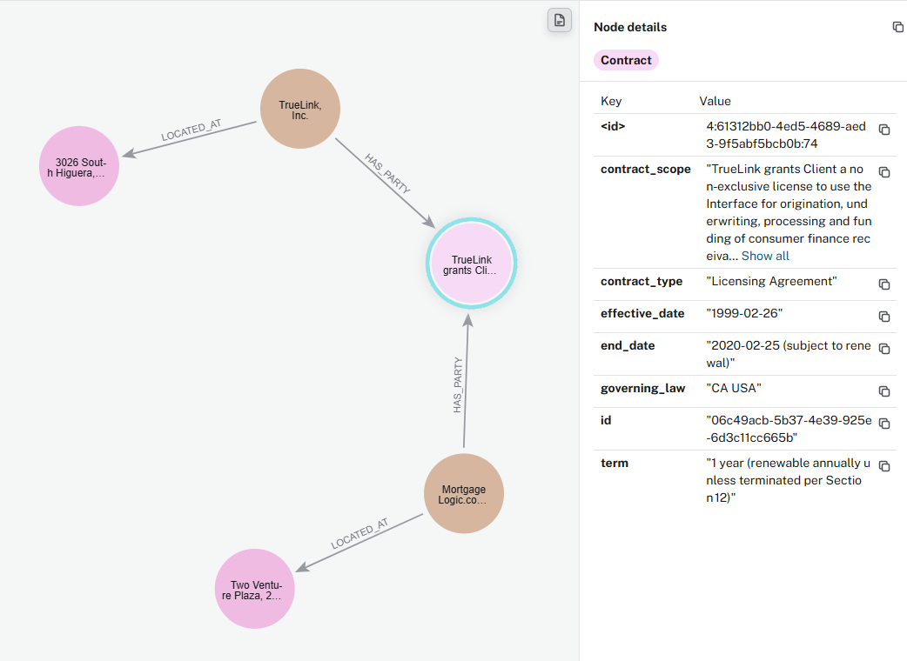
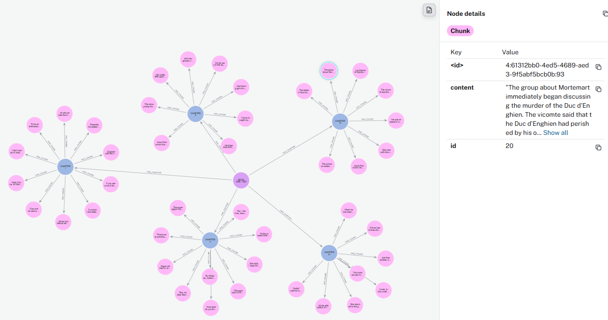
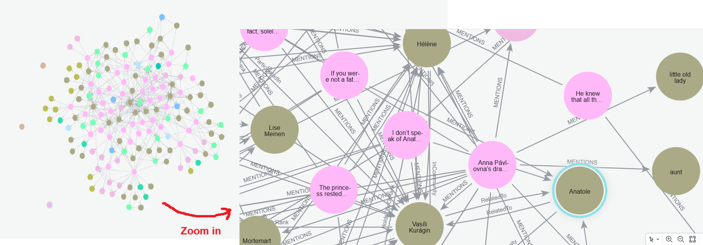
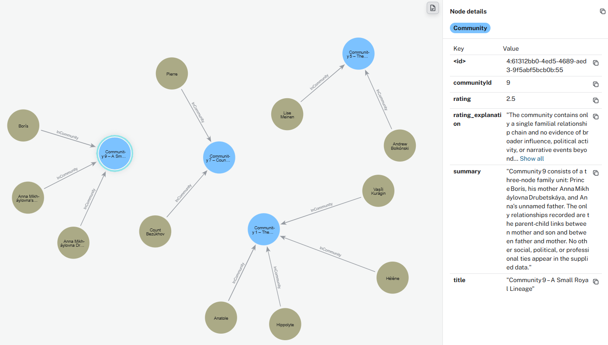
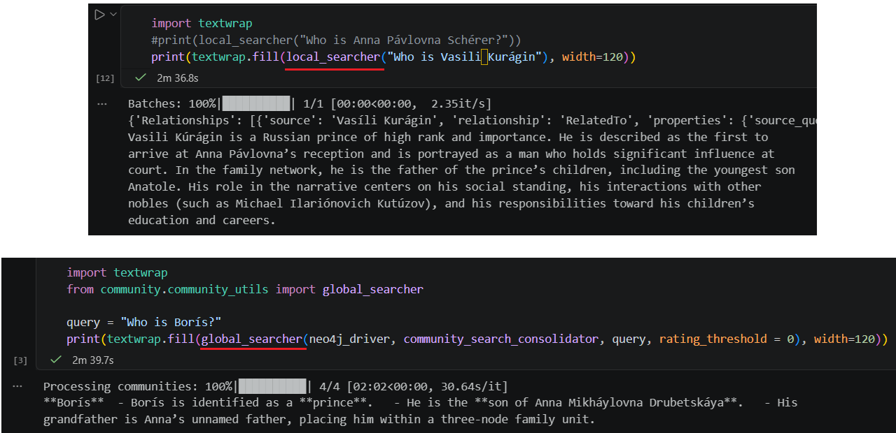
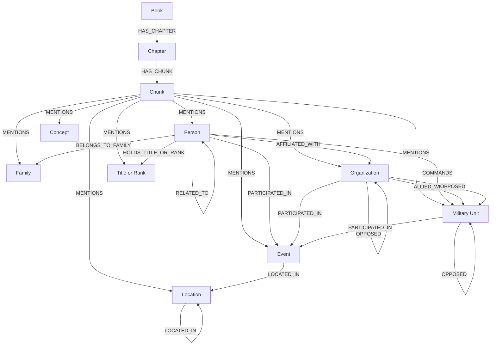
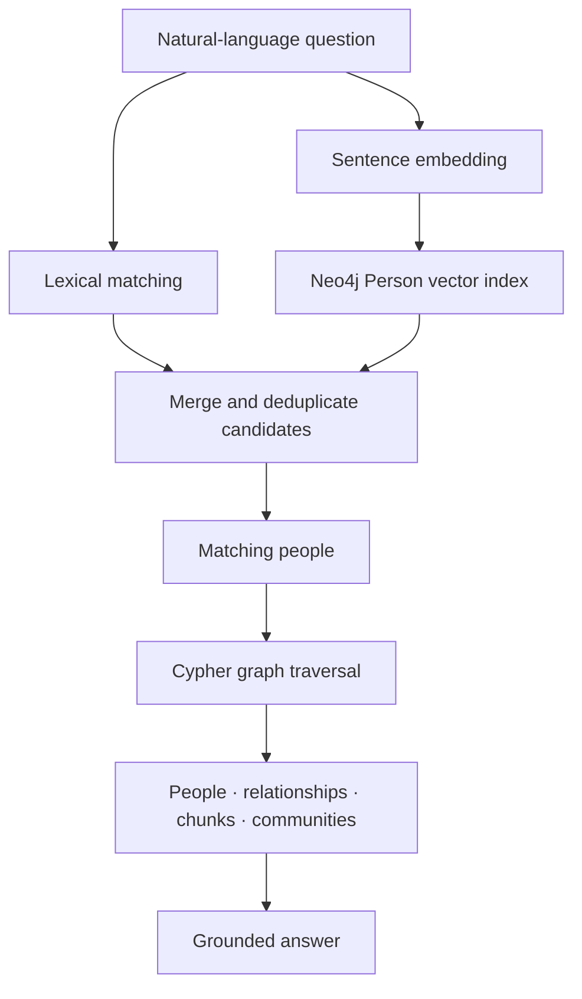
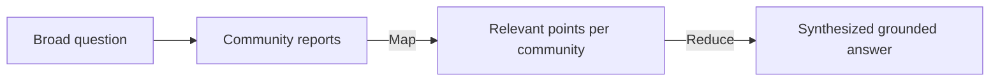

# Knowledge Graph RAG

**Transform unstructured text into knowledge graphs. Discover relationships. Retrieve information. Generate grounded answers.**


**Knowledge Graph RAG** is an experimental pipeline that transforms unstructured text into structured knowledge graphs, making entities, relationships and their connections explorable and enabling grounded question answering.

It combines:

- **LLM-powered extraction** – identifies entities, relationships, canonical names and supporting evidence.
- **Knowledge graph construction** – models extracted information and source provenance in Neo4j.
- **Entity resolution** – consolidates different references to the same entities.
- **Community detection** – discovers interconnected groups using Neo4j Graph Data Science and Louvain.
- **Local LLM inference** – uses Ollama to run models without relying on commercial LLM APIs.
- **Semantic retrieval** – combines vector search and graph traversal.
- **GraphRAG question answering** – supports focused local queries and broader global analysis.

> **Proof of concept:** The current implementation uses Leo Tolstoy's *War and Peace* as its demonstration corpus, focusing on five chapters from Book One. The ontology is tailored to the source text and must be adapted to other documents and domains.

---

## Design constraints: local inference

The project was developed without access to a GPU and I wanted to avoid the recurring costs of commercial LLM API.

I therefore chose to run an open-weight LLM locally through Ollama, using `gpt-oss:20b` for information extraction, entity resolution and report generation.

This introduced practical constraints on model inference time, memory consumption and processing throughput. To keep the experiment manageable, I limited the initial corpus to five chapters from Book One of *War and Peace*.

The intention was not to produce a complete representation of the novel, but to validate the architecture and demonstrate a reusable approach to transforming unstructured text into a knowledge graph.

Although the current implementation uses War and Peace as its demonstration corpus, the underlying processing and retrieval architecture can be adapted to other text collections and domains. The ontology and extraction rules would need to be tailored to the characteristics of each source.

## Showcase

### Contract example

This example defines an ontology and demonstrates structured entity and relationship extraction using Pydantic.
It demonstrates how unstructured text becomes an entity-rich graph contract.

<p align="center">
  
</p>

### Document structure

The source text is divided into overlapping sentence-aware chunks, while chapter and book relationships preserve its provenance.

<p align="center">
  
</p>

### Knowledge graph

The following graph illustrates the entities and relationships extracted from the first five chapters of *War and Peace*:

<p align="center">
  
</p>

### Community detection

Neo4j GDS identifies Louvain communities of interconnected people. An LLM then produces structured summaries and subjective assessments of each community's narrative significance. These ratings are interpretative assessments, not graph-theoretical metrics.

<p align="center">
  
</p>

### GraphRAG retrieval

Examples of global and local retrieval:

<p align="center">
  
</p>

---

## What the project does

### 1. Builds a knowledge graph from text

The pipeline reads the novel, normalizes whitespace and creates overlapping chunks using NLTK sentence tokenization. Each chunk is then sent to a local LLM with:

- a strict extraction ontology
- canonical naming rules
- relationship endpoint constraints
- exact source-evidence requirements
- Pydantic response validation

Extracted entities and relationships are consolidated across chunks and chapters. Repeated references are normalized, corroborating evidence is merged and conflicting values are retained for inspection.

### 2. Stores provenance in Neo4j

The graph preserves the hierarchy from book to chapter to source chunk and links chunks to the entities they mention.

Typical graph structure:



The write path uses Neo4j constraints and `MERGE` operations for stable node and relationship identities.

### 3. Answers questions in two ways

| Retrieval mode | Best for | Mechanism |
|---|---|---|
| **Local search** | Person-specific and nearby-context questions | Vector similarity → Neo4j traversal → chunks, relationships and reports |
| **Global search** | Cross-community themes and broad questions | Community reports → map extraction → reduce synthesis |

#### Local search



Local search combines lexical matching against canonical names and aliases with semantic vector search using `all-MiniLM-L6-v2` embeddings to identify relevant characters.

These characters become starting points for Neo4j graph traversal, which retrieves:

- Person descriptions and supporting evidence
- Original text chunks mentioning the matched characters
- Relationships between matched characters
- Associated community reports

The retrieved context is then provided to an LLM to generate a grounded answer.

#### Global search



Global search operates on previously generated community reports and applies a map-reduce workflow:

1. Retrieve community reports above an optional rating threshold.
   The optional rating threshold filters communities according to their assessed narrative significance. It is not a semantic relevance score, so applying it may exclude communities containing information relevant to a particular question.
2. Ask the LLM to extract query-relevant information from each community report independently.
3. Consolidate the results into one coherent answer.
4. Preserve community references and flag contradictions or insufficient evidence.

---

## Graph ontology

The extraction schema represents both **entities** and **relationships**.

The ontology used in this project was designed specifically for the concepts and relationships identified in the source text. It is therefore an application-specific ontology rather than a predefined, universal schema. For other text collections or domains, the entity and relationship types can be adapted or extended to reflect their particular characteristics.

### Entity types

| Type | Examples |
|---|---|
| `PERSON` | A character or identifiable individual |
| `FAMILY` | A dynasty, lineage or family |
| `ORGANIZATION` | A government, institution or organized body |
| `LOCATION` | A country, city, estate or landmark |
| `MILITARY_UNIT` | An army, regiment or other formation |
| `EVENT` | A battle, reception, gathering or other occurrence |
| `TITLE_OR_RANK` | An aristocratic title, rank or court position |
| `CONCEPT` | A recurring or independently identifiable idea |

### Relationship types

| Relationship | Allowed direction |
|---|---|
| `BELONGS_TO_FAMILY` | Person → Family |
| `RELATED_TO` | Person → Person |
| `AFFILIATED_WITH` | Person → Organization |
| `HOLDS_TITLE_OR_RANK` | Person → Title or Rank |
| `COMMANDS` | Person → Military Unit |
| `PART_OF` | Military Unit → Military Unit |
| `PARTICIPATED_IN` | Person, Organization or Military Unit → Event |
| `LOCATED_IN` | Event or Location → Location |
| `ALLIED_WITH` | Organization or Military Unit → Organization or Military Unit |
| `OPPOSED` | Organization or Military Unit → Organization or Military Unit |

Pydantic models provide runtime validation and structured JSON output (see [War & Peace Pydantic structures](src/graphrag/war_and_peace_schemas.py)). They implement much of the practical ontology, while remaining separate from a formal ontology language such as OWL.

---

## Repository layout

```text
.
├── data/
│   ├── war_and_peace.txt       # Project Gutenberg source corpus (if direct download fails)
│   └── license_agreement.txt   # Contract analysed by contracts.ipynb
├── docs/
│   ├── contract-example.png    # Images 
│   └── ...
│
├── neo/
│   └── compose.yaml            # Neo4j + Graph Data Science
├── notebooks/
│   ├── load_tolstoy.ipynb      # Corpus loading and graph construction
│   ├── proc_tolstoy.ipynb      # Processing, communities and retrieval
│   └── contracts.ipynb         # Contract and extraction experiments
├── src/
│   ├── graphrag/
│   │   ├── llm.py              # Prompts and local OpenAI-compatible client
│   │   ├── war_and_peace_schemas.py
│   │   ├── graph_utils.py      # Chunking, consolidation and Neo4j writes
│   │   └── gen_utils.py        # NLTK chunk generation
│   └── community/
│       ├── community_utils.py   # Louvain, embeddings and retrieval
│       ├── community_llm.py     # Global and local search prompts
│       └── data.py              # Community response models
├── pyproject.toml
└── uv.lock
```

---

## Notebooks

The repository includes three notebooks:

- **`contracts.ipynb`** – An introductory proof of concept demonstrating how unstructured text can be transformed into an explorable knowledge graph. It analyses [this contract](data/license_agreement.txt).
- **`load_tolstoy.ipynb`** – Extracts entities and relationships from *War and Peace* and builds a knowledge graph structured according to the project's ontology.
- **`proc_tolstoy.ipynb`** – Processes and enriches the resulting graph, identifies communities, generates community reports, and implements graph-based retrieval and question answering.

---

## Requirements

- **Python 3.13**
- **[uv](https://docs.astral.sh/uv/)**
- **Docker** with Docker Compose
- **Ollama**
- The local model `gpt-oss:20b`
- The gpt-oss:20b model requires substantial memory. Actual requirements depend on quantization, context length and Ollama configuration. CPU-only inference is supported, but processing can be considerably slower than GPU inference.

The Python environment includes Neo4j drivers, Pydantic, OpenAI-compatible tooling, NLTK, Sentence Transformers and tqdm.

---

## Quick start

### 1. Start Neo4j

Create `neo/.env` with the Neo4j credentials:

```dotenv
NEO4J_USER=neo4j
NEO4J_PASSWORD=mypassword
```
> An [example](neo/.env.example) is provided.

Then start Neo4j:

```bash
cd neo
docker compose --env-file .env up -d
```

Open the Neo4j Browser at <http://localhost:7474>.

The Compose configuration exposes:

| Endpoint | Purpose |
|---|---|
| `7474` | Neo4j Browser and HTTP |
| `7687` | Bolt driver |

It also mounts Neo4j data persistently and enables the Graph Data Science plugin.

### 2. Start Ollama

Install Ollama, then make it available on the network interface used by the project:

**Linux or WSL**

```bash
export OLLAMA_HOST=0.0.0.0:11434
export OLLAMA_CONTEXT_LENGTH=16384
ollama serve
```

**Windows PowerShell**

```powershell
$env:OLLAMA_HOST = "0.0.0.0:11434"
$env:OLLAMA_CONTEXT_LENGTH = "16384"
ollama serve
```

In a separate terminal, pull the model:

```bash
ollama pull gpt-oss:20b
```

Verify it is reachable:

```bash
curl http://localhost:11434/api/tags
```

The current `get_openai_client()` implementation is configured to use 

```bash
ollama_url = os.getenv("OLLAMA_URL", "http://localhost:11434/v1")
```

where `OLLAMA_URL` is configured in `.env`. Change this if needed.


### 3. Configure the Python environment

From the repository root:

```bash
uv sync
```

Create a project `.env`:

```dotenv
OLLAMA_URL=http://localhost:11434/v1
NEO4J_URI=bolt://localhost:7687
NEO4J_USER=neo4j
NEO4J_PASSWORD=choose-a-strong-password
```

> An [example](.env.example) is provided.

The Neo4j Compose file reads `NEO4J_USER` and `NEO4J_PASSWORD` from `neo/.env`; the application reads `NEO4J_USER`, `NEO4J_URI` and `NEO4J_PASSWORD` from the project `.env`.

### 4. Launch the notebooks

```bash
uv run --with jupyterlab jupyter lab
```

Open and run the notebooks from `notebooks/`:

1. **`contracts.ipynb`** - introductory contract analysis and extraction proof of concept
2. **`load_tolstoy.ipynb`** - corpus loading and knowledge-graph construction
3. **`proc_tolstoy.ipynb`** - community detection and GraphRAG retrieval

Enable the notebook dotenv extension and load the project `.env` before opening clients or creating Neo4j sessions.

The [_War and Peace_ text](https://www.gutenberg.org/files/2600/2600-0.txt) used by this project is sourced from [Project Gutenberg](https://www.gutenberg.org/), a volunteer-driven digital library of public-domain books. The download may be blocked by some HTTP clients or network configurations. If that happens, download the text manually through a browser and save it as `data/war_and_peace.txt`.

> **`load_tolstoy.ipynb`** is already prepared to download the book from Gutenberg site, with fallback to reading it from `data/war_and_peace.txt`.

---

## Example questions

Local search is useful for entity-oriented questions:

```text
Who is Anna Pavlovna Scherer?
Who is Vasili Kuragin?
How is Anatole Kuragin connected to his family?
What places are associated with this character?
```

Global search is useful for questions that span communities:

```text
Which communities contain the strongest social or political relationships?
How do the aristocratic families interact across the graph?
What events connect multiple characters or communities?
```

Answers are expected to be evidence-aware: retrieved chunks and relationship context should support the claims, while missing evidence should not be treated as a negative fact.

---

## Quality and reliability

This project deliberately treats extraction as a data-quality problem rather than a single best-effort LLM call.

- **Canonical person names** remove titles and honorifics from person nodes
- **Exact quotations** link extracted facts to source text
- **Evidence sentences** retain only meaningful statements about a person
- **Entity resolution** merges alternate references to the same individual
- **Relationship properties** preserve evidence and direction
- **Strict Pydantic schemas** reject malformed or out-of-ontology output
- **Community prompts** distinguish facts, graph observations and interpretation
- **Search prompts** discourage unsupported claims and missing-evidence inference

Extraction remains probabilistic and graph quality is limited by:

- the selected model
- the proof-of-concept source scope
- chunk boundaries
- OCR or text formatting
- unresolved aliases
- incomplete relationship coverage

---

## Project status and scope

The current proof of concept demonstrates the GraphRAG pipeline on a deliberately small corpus: five chapters from Book One of *War and Peace*. It is a learning and portfolio project, intended to demonstrate the architecture and core processing and retrieval workflows rather than provide a complete literary dataset or a production-ready GraphRAG system.

**Implemented**

- Text loading, sentence-aware chunking and source provenance.
- LLM-based entity and relationship extraction with structured output validation.
- Entity consolidation and resolution within each chapter.
- Neo4j knowledge graph construction.
- Louvain community detection and LLM-generated community reports.
- Local retrieval combining lexical matching, vector search and graph traversal.
- Global retrieval using a Map-Reduce approach over community reports.

**Planned extensions**

- Configurable corpus, book and chapter selection.
- Complete graph rebuilds with resumable ingestion.
- Richer cross-chapter entity resolution.
- Conflict and provenance reporting.
- Automated ingestion and retrieval scripts.
- Tests for schema, Cypher and retrieval behavior.
- Evaluation of retrieval relevance and answer faithfulness.

---

## Acknowledgments

The project uses an adapted literary GraphRAG example from Manning's **[_Essential GraphRAG: Knowledge Graph-Enhanced RAG_](https://www.manning.com/books/essential-graphrag)** as a conceptual starting point for transforming unstructured text into an explorable knowledge graph.

The demonstration source is Leo Tolstoy's _War and Peace_, included in `data/war_and_peace.txt`.

## Copyright and source attribution

The demonstration corpus uses Leo Tolstoy's *War and Peace*, obtained from [Project Gutenberg](https://www.gutenberg.org/files/2600/2600-0.txt):

| | |
|---|---|
| Title | War and Peace|
| Author | Leo Tolstoy|
| Translators | Louise and Aylmer Maude|
| Release Date | April 2001, eBook #2600|
| Most recently updated | June 14, 2022|
| Language | English|


Tolstoy's original work is in the public domain in many jurisdictions, including the European Union.

Project Gutenberg is the source of the electronic text used in this project. The copyright status of individual editions and translations must be assessed separately.

This project uses the source text for computational analysis, including text chunking, entity and relationship extraction, semantic embedding, knowledge-graph construction and question answering.

Project Gutenberg is not affiliated with or endorsing this project.

Source: [Project Gutenberg – War and Peace](https://www.gutenberg.org/ebooks/2600)